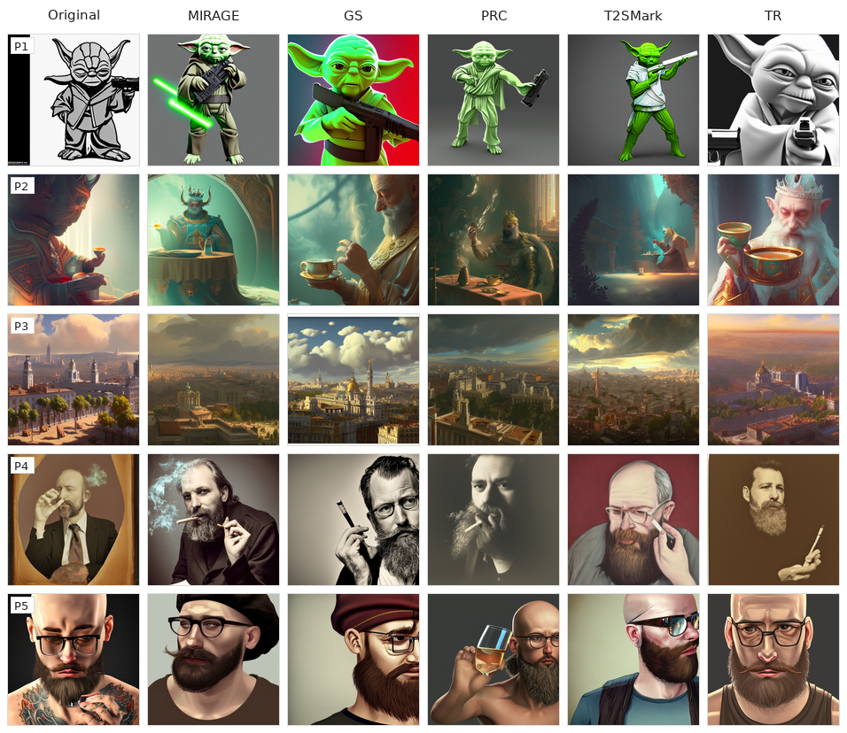
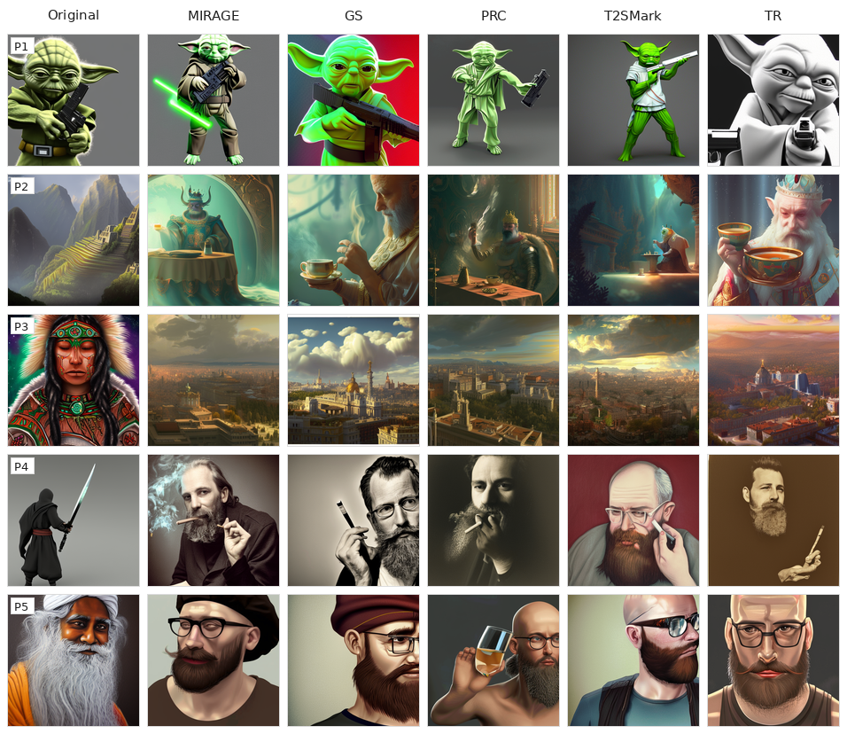
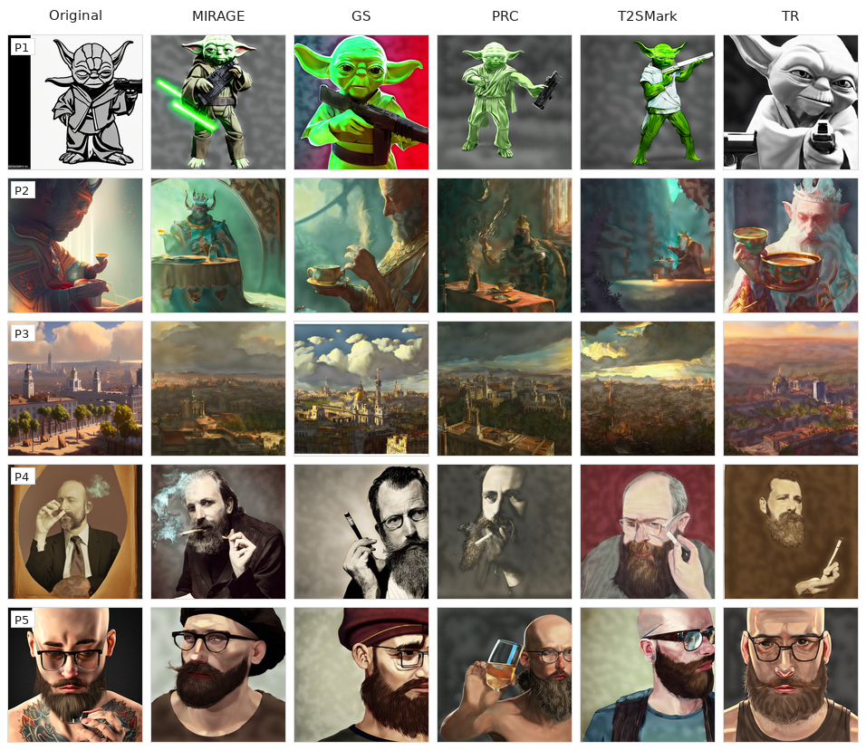

# LatentSieve: Reliability-Aware Decoding for Noise-Space Diffusion Watermarks

Anonymous code release for the USENIX Security 2027 submission **LatentSieve: Reliability-Aware Decoding for Noise-Space Diffusion Watermarks**.

Contains the LatentSieve implementation, the four baseline schemes (Tree-Ring, Gaussian Shading, PRC, T2SMark), and the evaluation scripts that produce the experimental results in the paper.

> *Submission under double-blind review. Do not contact or attempt to deanonymize the authors.*

---

> **Naming.** The scheme is called LatentSieve in the paper. The code predates the
> rename and still uses `MIRAGE` for the algorithm name, config files
> (`config/MIRAGE_presence.json`), and output paths. They refer to the same scheme.

---

## 1. Repository Layout

```
latentsieve_release/
├── README.md
├── assets/gallery/              # README visual examples
├── tools/                       # Release helper scripts
├── MarkDiffusion/                # LatentSieve + baselines + evaluation
│   ├── watermark/{mirage,gs,prc,tr}/   # Embedding implementations
│   ├── detection/{mirage,gs,prc,tr}/   # Matched decoders
│   ├── config/                         # Per-scheme JSON configurations
│   ├── utils/, evaluation/             # Shared utilities + attack pipelines
│   ├── runtime_utils.py, sdp_n500_config.py
│   ├── eval_*.py                       # Evaluation scripts
│   ├── requirements.txt
│   └── LICENSE                         # Apache 2.0
└── T2SMark/                            # T2SMark baseline (upstream, Apache 2.0)
```

## 2. Installation

```bash
conda create -n latentsieve python=3.10 -y
conda activate latentsieve
cd MarkDiffusion
pip install -r requirements.txt
```

Stable Diffusion 2.1-base is the default backbone; weights download from Hugging Face on first use. SDXL and FLUX.1-dev are also supported but require additional disk space and longer inversion.

## 3. Visual Examples

Each row below is one SDP prompt/seed pair. Columns compare the paired unwatermarked original with LatentSieve and four baseline watermarks.

**Clean watermarked outputs**



**After Ctrlgen removal attack**



**After UnMarker-S2 removal attack**



**SHIFT trajectory deflection ($\lambda = 0.5$)**


**SHIFT trajectory deflection ($\lambda = 0.7$)**


The checked-in gallery images were built from cached evaluation outputs. The helper script `tools/make_readme_gallery.py` is for release preparation and expects those cached outputs to be present locally.

## 4. Quick Start

Embed a watermark and run the standard attack suite:

```bash
cd MarkDiffusion
python eval_n500_standard_attacks.py --gpu 0 --num-images 100
```

Run the SHIFT cross-scheme comparison at $\lambda = 0.7$:

```bash
python eval_n500_shift_sdp.py --gpu 0 --scheme MIRAGE --lambdas 0.7
python eval_n500_shift_sdp.py --gpu 0 --scheme GS    --lambdas 0.7
python eval_n500_shift_sdp.py --gpu 0 --scheme PRC   --lambdas 0.7
python eval_n500_shift_sdp.py --gpu 0 --scheme TR    --lambdas 0.7
```

Run the erasure-aware white-box adaptive attack (worst-case key compromise):

```bash
python eval_n200_adaptive_whitebox_lpips.py --gpu 0 --num-images 100 \
    --latent-budgets 5.0,20.0,50.0,100.0,200.0
```

## 5. Mapping from Paper Results to Scripts

Numbering matches the compiled submission PDF. Every entry was checked by taking
values from the printed table and locating the record that contains them; where
a table pools shards, all of them are listed. Scripts are under `MarkDiffusion/`
and take `--gpu N`; the release drops the `qi_` prefix used in the working tree.

| Paper item | Script | Raw record |
|---|---|---|
| Table 2 (MS-COCO robustness, N=1000) | `eval_mirage_1k.py` | `qi_mirage_1k_results.json` |
| Table 3 (cross-scheme: extreme, learned removal, SHIFT, UnMarker, FID) | `eval_n500_strength_sweep_sdp.py`, `eval_extreme_cross_scheme.py`, `eval_extreme_t2smark.py`, `attack_learned_sdp.py`, `attack_ctrlgen_sdp.py`, `eval_n500_shift_sdp.py`, `eval_n500_unmarker_*.py`, `eval_fid_coco_1k.py` | `qi_eval_n500_sdp/{extreme,learned_*,shift_results,unmarker_*}`, `qi_fid_coco_1k_*.json` |
| Table 4 (cross-scheme counterfactual, stored vs key-derived reference) | `eval_keyref_counterfactual.py` (key-derived), `eval_gs_t2s_counterfactual.py` and `eval_prc_counterfactual.py` (stored), merged by `analyze_keyref.py` | `qi_eval_n500_sdp/{gs,prc,t2smark}_keyref_counterfactual_{lo,hi}.json` |
| Table 5 (mechanism disentangling M1-M4 + cross-scheme) | `eval_n500_gzs_shift_sdp.py`, `analyze_keyref.py` | `qi_eval_n500_sdp/gzs_shift_comparison.json` |
| Table 6 (OOD false positives) | `eval_fpr_10k.py`, `eval_ood_false_positive.py` | `qi_eval_n500_sdp/fpr_null_10k_offset{0,5000}.json`, `qi_ood_fp_200.json` |
| Table 7 (scheme-aware adaptive attacks) | `eval_adaptive_attack.py`; f=0 column from `eval_adaptive_roundtrip_baseline.py`; LPIPS from `eval_adaptive_lpips_v2.py` | `qi_eval_n500/adaptive_attack_n500.json` |
| Table 8 (hyperparameter ablation) | `eval_mirage_ablation.py` | `qi_mirage_ablation.json` |
| Table 9 (unseen and combo attacks) | `eval_n500_unseen_combo_sdp.py` | `qi_eval_n500_sdp/unseen_combo_mirage.json` |
| Table 10 (regeneration img2img) | `eval_regeneration_attack.py` | `qi_regeneration_attack.json` |
| Table 11 (SD 1.5 transfer) | `eval_n500_sd15.py` | `qi_eval_n500/sd15_mirage.json` |
| Table 12 (SDXL and FLUX transfer) | `sdxl_mirage.py`, `flux_mirage_sdp_n500.py` | `qi_overnight_logs/sdxl_BA_n500_g{0,1,2}.json`, `qi_flux_n500_off{0,167,334}.json` |
| Table 13 (stratified per-magnitude flip rate) | `eval_n500_sigma_table.py` | `qi_eval_n500_sdp/sigma_table.json` |
| Table 14 (undetectability battery) | `eval_undetectability.py` | `qi_eval_n500/undetectability.json` |
| Table 15 (runtime per stage) | `measure_runtime.py` | `qi_runtime_results.log` |
| Figure 3 (Sheppard bound validation) | `eval_sign_agreement_attacks.py` | `qi_eval_n500_sdp/sigma_table.json` |
| Figure 4 (TPR vs shared threshold) | `eval_n500_shift_sdp.py` + `eval_fpr_10k.py` null | `qi_eval_n500_sdp/shift_results/{MIRAGE,GS}_shift.json`, `far_cross_scheme.json` |
| Figure 5 (SHIFT frontier: lambda sweep + FAR budget) | `eval_n500_shift_sdp.py`, then the FAR panel from `eval_fpr_10k.py` null | `qi_eval_n500_sdp/shift_results/{MIRAGE,GS}_shift.json` |
| Figure 6 (attack-strength sweep) | `eval_n500_strength_sweep_sdp.py` | `qi_eval_n500_sdp/strength_sweep_mirage.json` |
| §7 white-box adaptive (inline) | `eval_n200_adaptive_whitebox_lpips.py` | `qi_eval_n500_sdp/adaptive_wb_lpips_merged.json` |
| §H T2SMark key-length security (inline) | `eval_t2smark_shortkey_search_calibration.py` | — |

T2SMark needs its own
inversion pipeline, so every T2SMark measurement uses the `eval_n500_t2smark_*`
counterpart of the script listed above.

### Known defects and gaps

These are real and were found while re-verifying the tables. They do not change
any published number, but they affect what a reproducer can regenerate.

- **`eval_mirage_1k.py` no longer builds the unwatermarked arm.** A guard skips
  it ("FPR already validated on 1000+ OOD images"), so the FPR and Null_max
  columns of Table 2 cannot be regenerated without restoring that branch. The
  published values come from that run's own unwatermarked arm (N=1000), which is
  why the null maxima differ per attack.
- **`eval_mirage_1k.py --save-images` is a dead flag.** The directories are
  created but no image is ever written, despite the closing message. FID cannot
  be reproduced from this script; use `eval_fid_coco_1k.py`.
- **Stochastic attacks are not bit-reproducible.** Noise-15, Noise-50 and
  Overlay draw unseeded randomness. Their TPR is stable to within 0.001 across
  reruns, but per-attack BA minima move by up to 0.04.
- **T2SMark FID uses its own unwatermarked reference set**, not the shared one,
  so its value in Table 3 ranks alongside the other three rather than against
  them.
- **Tables 11, 13 and 14 have no unwatermarked arm**, so they carry no
  false-positive rate. The FPR evidence for those settings is Table 6.
- **FLUX.1-dev is a gated checkpoint.** Table 14's FLUX row cannot be rerun
  without accepted-licence credentials; the per-image records are shipped so the
  aggregate remains checkable.

## 6. Reproducibility

- All scripts seed PyTorch and NumPy via `runtime_utils.configure_runtime()`.
- The cross-scheme SDP slice is fixed: 100 prompts × 5 seeds = 500 images, identical across schemes for paired statistical tests.
- Raw per-image scores are logged as JSON; aggregation recomputes paper numbers from these logs.
- Confidence intervals use the Wilson score; McNemar tests use Edwards' continuity correction.

## 7. Licensing

Apache 2.0 (`MarkDiffusion/LICENSE`, `T2SMark/LICENSE`).
