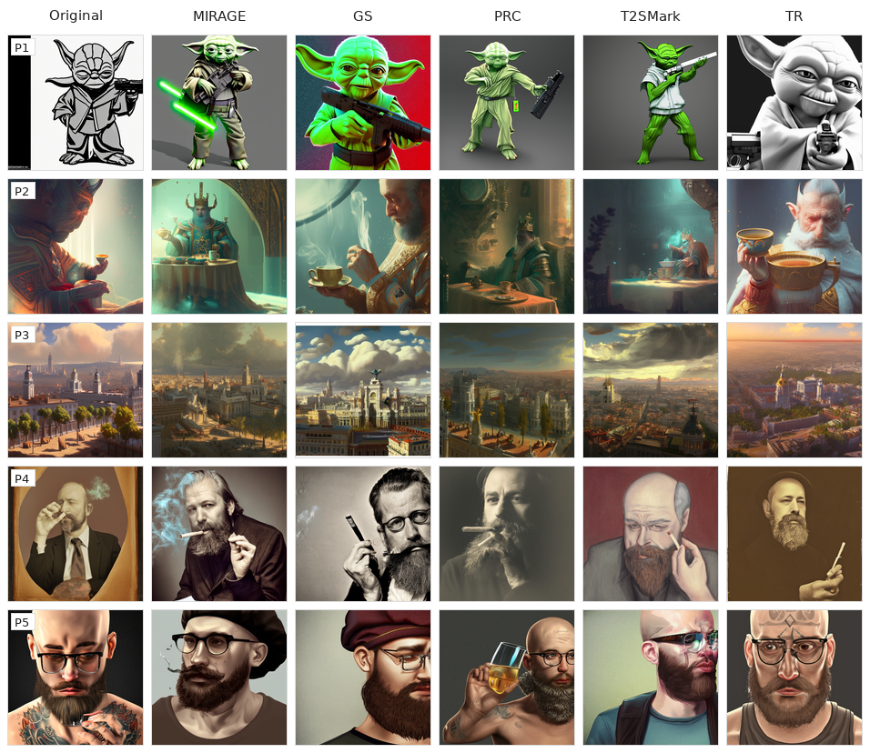
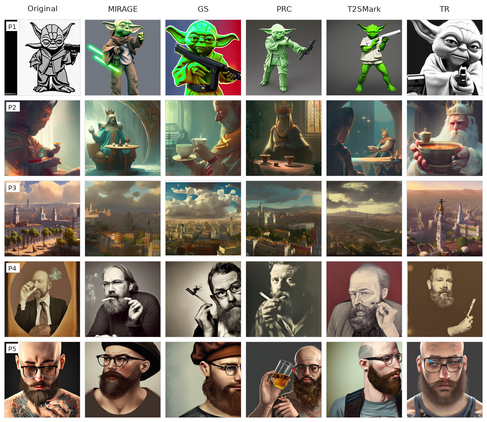

# LatentSieve: Reliability-Aware Decoding for Noise-Space Diffusion Watermarks

This repository contains the LatentSieve implementation, four watermarking baselines (Tree-Ring, Gaussian Shading, PRC, and T2SMark), and the evaluation scripts. See [Reproducibility](#5-reproducibility) for the data behind the decoder comparisons and the additional false-positive measurements.

---

> **Naming.** The scheme is called LatentSieve in the paper. The code predates the
> rename and still uses `MIRAGE` for the algorithm name, config files
> (`config/MIRAGE_presence.json`), and output paths. They refer to the same scheme.

---

## 1. Repository Layout

```
LatentSieve/
├── README.md
├── artifacts/                  # Score data and analysis scripts
├── assets/gallery/              # README visual examples
├── tools/                       # Release helper scripts
├── MarkDiffusion/                # LatentSieve + baselines + evaluation
│   ├── watermark/{mirage,gs,prc,tr}/   # Embedding implementations
│   ├── detection/{mirage,gs,prc,tr}/   # Matched decoders
│   ├── config/                         # Per-scheme JSON configurations
│   ├── utils/, evaluation/             # Shared utilities + attack pipelines
│   ├── runtime_utils.py, sdp_n500_config.py
│   ├── eval_*.py                       # Evaluation scripts
│   ├── requirements.txt
│   └── LICENSE                         # Apache 2.0
└── T2SMark/                            # T2SMark baseline (upstream, Apache 2.0)
```

## 2. Installation

```bash
conda create -n latentsieve python=3.10 -y
conda activate latentsieve
cd MarkDiffusion
pip install -r requirements.txt
```

Stable Diffusion 2.1-base is the default backbone; weights download from Hugging Face on first use. SDXL and FLUX.1-dev are also supported but require additional disk space and longer inversion.

## 3. Visual Examples

Each row below is one SDP prompt/seed pair. Columns compare the paired unwatermarked original with LatentSieve and four baseline watermarks.

**Clean watermarked outputs**


**After Ctrlgen removal attack**


**After UnMarker-S2 removal attack**


**SHIFT trajectory deflection ($\lambda = 0.5$)**



**SHIFT trajectory deflection ($\lambda = 0.7$)**



The checked-in gallery images were built from cached evaluation outputs. The helper script `tools/make_readme_gallery.py` is for release preparation and expects those cached outputs to be present locally.

## 4. Quick Start

Embed a watermark and run the standard attack suite:

```bash
cd MarkDiffusion
python eval_n500_standard_attacks.py --gpu 0 --num-images 100
```

Run the SHIFT cross-scheme comparison at $\lambda = 0.7$:

```bash
python eval_n500_shift_sdp.py --gpu 0 --scheme MIRAGE --lambdas 0.7
python eval_n500_shift_sdp.py --gpu 0 --scheme GS    --lambdas 0.7
python eval_n500_shift_sdp.py --gpu 0 --scheme PRC   --lambdas 0.7
python eval_n500_shift_sdp.py --gpu 0 --scheme TR    --lambdas 0.7
```

Run the erasure-aware white-box adaptive attack (worst-case key compromise):

```bash
python eval_n200_adaptive_whitebox_lpips.py --gpu 0 --num-images 100 \
    --latent-budgets 5.0,20.0,50.0,100.0,200.0
```


## 5. Reproducibility

The [score archive](artifacts/decoder_score_artifact.zip) contains paired scores for uniform scoring, hard erasure, and soft block weighting, along with per-image block agreement counts, calibration settings, and the analysis scripts. It also includes verification scores on unmarked images for the fixed-cutoff distortion panels on SD 2.1, SD 1.5, and FLUX.1-dev. The SDXL transfer figures come from a separate archived evaluation.

Extract the archive from the repository root and follow its `README.md` for the threshold and bootstrap analyses. To regenerate the per-condition false-positive summary from the supplied scores:

```bash
python -m zipfile -e artifacts/decoder_score_artifact.zip score_artifact
cd score_artifact/distortion_null
python summarize_distortion_null.py sd15.csv sd21.csv flux.csv --output reproduced.json
```

The summary reports the false-positive count, maximum score, and 95% Wilson upper endpoint for each condition at the original cutoff of 0.67. Each panel reuses its base images across conditions.

### Image-level evaluation

- All scripts seed PyTorch and NumPy via `runtime_utils.configure_runtime()`.
- The cross-scheme SDP slice is fixed: 100 prompts × 5 seeds = 500 images, identical across schemes for paired statistical tests.
- Raw per-image scores are logged as JSON; aggregation recomputes paper numbers from these logs.
- Confidence intervals use the Wilson score; McNemar tests use Edwards' continuity correction.

## 6. Licensing

Apache 2.0 (`MarkDiffusion/LICENSE`, `T2SMark/LICENSE`).
